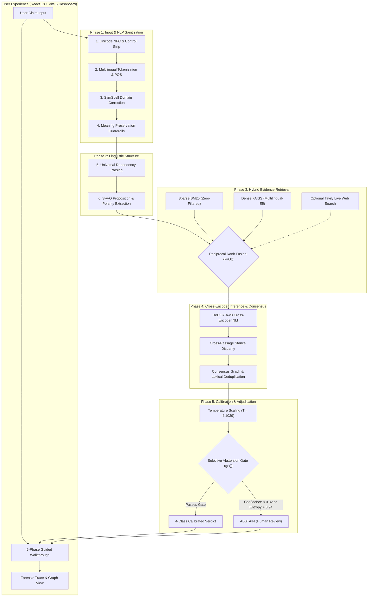

<!-- ============================================================================== -->
<!-- VERITAS-X: Multilingual Evidentiary Fact Verification & Forensic Intelligence -->
<!-- ============================================================================== -->

<p align="center">
  
</p>

<p align="center">
  <strong>Evidence-Grounded Claim Verification</strong>
</p>

<p align="center">
  <em>An audited neuro-symbolic verification engine coupling dense/sparse hybrid retrieval, cross-encoder NLI, calibrated temperature scaling (T = 4.1039), and transparent 11-stage forensic telemetry.</em>
</p>

<p align="center">
  <a href="https://www.python.org/"></a>
  <a href="https://pytorch.org/"></a>
  <a href="https://developer.nvidia.com/cuda-toolkit"></a>
  <a href="https://huggingface.co/MoritzLaurer/DeBERTa-v3-base-mnli-fever-anli"></a>
  <a href="https://github.com/facebookresearch/faiss"></a>
  <a href="ui/veritas-x-advanced-ui/"></a>
  <a href="#-verification--testing"></a>
  <a href="LICENSE"></a>
</p>

<p align="center">
  <a href="#-why-veritas-x">Why VERITAS-X?</a> •
  <a href="#-quickstart-one-click-launch">Quickstart</a> •
  <a href="#-end-to-end-architecture">Architecture</a> •
  <a href="#-four-class-veracity-taxonomy">Veracity Taxonomy</a> •
  <a href="#-audited-benchmarks--calibration">Audited Benchmarks</a> •
  <a href="#-api-specification">API Reference</a> •
  <a href="#-verification--testing">Testing</a>
</p>

---

## 🔍 Executive Overview

Modern Large Language Models (LLMs) produce confident assertions without citing verifiable primary sources, frequently generating plausible-sounding **factual hallucinations**. Furthermore, standard classification pipelines suffer from severe **neural overconfidence**, single-source confirmation bias, and false conflict alarms.

**VERITAS-X** is an open-source, neuro-symbolic evidence verification platform built for multilingual discourse (English, Hindi, Bengali, and code-mixed Hinglish). Instead of treating fact-checking as a black-box question-answering task, VERITAS-X breaks verification down into an **audited 11-stage forensic pipeline**:

1. **Protective NLP Normalization:** Cleans text, shields named entities and URLs, and detects spelling corruptions using domain-weighted SymSpell with semantic guardrails.
2. **Hybrid Evidence Retrieval:** Merges lexical Okapi BM25 with dense semantic embeddings (`intfloat/multilingual-e5-small`) via Reciprocal Rank Fusion ($k=60$), querying a verified ground-truth corpus (1,047 passages) or optional live-web citations via Tavily API.
3. **Cross-Encoder Inference:** Computes premise-hypothesis entailment, contradiction, and neutral distributions using `MoritzLaurer/DeBERTa-v3-base-mnli-fever-anli`.
4. **Stance Disparity Analysis:** Evaluates opposing evidence claims across independent passages, suppressing duplicate documents and noisy neutral text to eliminate spurious conflict hallucinations.
5. **Calibrated Adjudication & Selective Abstention:** Scales logits with an audited post-hoc temperature ($T = 4.1039$), reducing Expected Calibration Error (ECE) from 23.1% to 10.6%, and triggers selective abstention on ambiguous or ungrounded claims.

---

## ⚡ Why VERITAS-X?

| Dimension | Raw LLM Prompting | Standard 2-Class Classifiers | VERITAS-X Forensic Platform |
| :--- | :--- | :--- | :--- |
| **Evidentiary Grounding** | Parametric memory (unverifiable) | Often trained on single sentences | **Multi-passage hybrid retrieval (BM25 + FAISS Dense + Web)** |
| **Confidence Reliability** | Uncalibrated, highly overconfident | Raw Softmax ($T=1.0$, overconfident) | **Audited multiclass temperature scaling ($T=4.1039$, ECE 10.6%)** |
| **Taxonomy Scope** | Binary True/False or freeform text | Binary True / False | **4-Class Taxonomy + Meta-Level Selective Abstention** |
| **Conflicting Claims** | Easily confused by contradictory text | Hallucinates conflict on rephrased text | **Cross-passage stance disparity with lexical deduplication** |
| **Process Visibility** | Opaque black-box generation | Single confidence score | **Transparent 11-stage execution trace with real-time telemetry** |
| **Abstention Safety** | Generates guesses when uncertain | Forces prediction regardless of score | **Principled abstention on low confidence or high entropy** |

> [!IMPORTANT]
> **Epistemic Disclosure:** A VERITAS-X verdict is an **evidence-based algorithmic evaluation conditioned strictly on retrieved documentary text**. It reflects the factual consistency between the input proposition and available citations; it is not an infallible metaphysical guarantee of real-world truth.

---

## 🎯 Four-Class Veracity Taxonomy

VERITAS-X enforces an unambiguous distinction between substantive domain classes and meta-level classification decisions:

```
                                  [ Input Claim Proposition ]
                                               │
                                 ┌─────────────┴─────────────┐
                    [ Sufficient Evidence Mass ]     [ Insufficient Evidence ]
                                 │                               │
                ┌────────────────┴────────────────┐              ▼
        [ Consistent Stance ]          [ Contradictory Stances ]  INSUFFICIENT_EVIDENCE
                │                                 │
        ┌───────┴───────┐                         ▼
        ▼               ▼            CONFLICTING_OR_CHERRYPICKED
  VERIFIED_TRUE   VERIFIED_FALSE
```

1. **`VERIFIED_TRUE`**: Retrieved evidence factually entails and substantiates the core proposition under standard physical or documented conditions.
2. **`VERIFIED_FALSE`**: Retrieved evidence directly refutes or contradicts the claim proposition.
3. **`CONFLICTING_OR_CHERRYPICKED`**: Independent, distinct evidence passages present contradictory stances, or selective quoting conceals critical counter-evidence. Requires active cross-passage disparity ($\tau_E \ge 0.35, \tau_C \ge 0.50, i \ne j$) across non-duplicate citations.
4. **`INSUFFICIENT_EVIDENCE`**: Retrieved evidence lacks informative mass ($< 0.10$), is dominated by neutral text, or contains no direct answers to core propositions.
5. **Selective Abstention (`ABSTAIN`)**: A meta-level decision ($g(x) \in \{0, 1\}$) triggered when maximum calibrated confidence is $< 0.32$ or normalized Shannon entropy is $> 0.94$. Abstained claims are routed for human review and are **not** conflated with `INSUFFICIENT_EVIDENCE`.

---

## 🏗️ End-to-End Architecture



### The 6-Phase User Workflow vs. 11-Stage Forensic Trace

| User-Facing Phase | Internal Trace Stages | Primary Responsibilities |
| :--- | :--- | :--- |
| **1. Input & Safety** | `evt_01` (Input), `evt_02` (Sanitize), `evt_03` (Spell), `evt_04` (Guardrail) | Standardizes Unicode NFC, protects entities/URLs, applies SymSpell, and verifies semantic preservation ($\ge 0.70$). |
| **2. Linguistic Analysis** | `evt_05` (Tokenize), `evt_06` (Linguistics), `evt_07` (Claim Extract) | Generates universal dependency trees, identifies Subject-Predicate-Object triples, and checks negation/modality. |
| **3. Evidence Discovery** | `evt_08` (Retrieval), `evt_09` (Evidence Processing) | Queries BM25 and dense FAISS index; deduplicates passages (Jaccard $\ge 0.75$) and prepares cross-encoder candidates. |
| **4. Stance Analysis** | `evt_10` (NLI Cross-Encoder) | Evaluates premise-hypothesis pairs with `DeBERTa-v3-base-mnli-fever-anli` to generate raw entailment, contradiction, and neutral logits. |
| **5. Calibration & Confidence** | `evt_10` (Calibration Step) | Scales logits by temperature $T = 4.1039$, penalizing neural overconfidence and producing reliable probabilities. |
| **6. Final Adjudication** | `evt_11` (Final Result) | Synthesizes calibrated probabilities into public taxonomy, evaluates the selective abstention gate, and outputs the verdict. |

---

## 📊 Audited Benchmarks & Calibration

All metrics derive from the audited held-out test split ($N=256$, stratified 50/50 split from AVeriTeC and Multilingual Diagnostic claims). All baseline figures are reconciled directly against the underlying confusion matrices.

### Benchmark Evaluation Summary

| Evaluation Metric | Phase 3.1 Baseline | Phase 3.2.5 Full-Test ($N=256$) | Delta vs. Baseline | Phase 3.2.5 Selective ($N=242$, Coverage: 94.53%) | Engineering Notes |
| :--- | :---: | :---: | :---: | :---: | :--- |
| **Accuracy** | 57.42% (147/256) | **59.38%** (152/256) | **+1.96 pp** | **62.40%** (151/242) | Selective accuracy evaluated on retained predictions |
| **Macro-F1 (4-Class)** | 44.24% | **43.34%** | -0.90 pp | **45.54%** | Retained Macro-F1 across 242 retained claims |
| **Macro-Precision** | 45.55% | **46.91%** | **+1.36 pp** | **47.76%** | Corrected from earlier transcription baseline |
| **Macro-Recall** | 50.34% | **49.07%** | -1.27 pp | **50.60%** | Controlled trade-off from conservative conflict gates |
| **Conflicting Precision** | 14.29% (4/28) | **28.57%** (2/7) | **+14.29 pp** | **28.57%** (2/7) | **Precision doubled (2x)**; false alarms cut by 79% |
| **Conflicting Recall** | 21.05% (4/19) | **10.53%** (2/19) | -10.53 pp | **11.76%** (2/17) | Known conservative constraint (honest disclosure) |
| **Coverage ($g(x)=1$)** | 100.0% | 100.0% | — | **94.53%** (242/256) | Meets $\ge 85\%$ target (14 claims safely abstained) |
| **Selective Risk** | 42.58% | 40.62% | -1.96 pp | **37.60%** | Full error ($1-\text{Acc}$) vs. selective risk on retained claims |

### Calibration Diagnostics (Test Logits, $N=256$, $T = 4.1039$)

Temperature scaling ($\hat{p} = \text{softmax}(\mathbf{z} / 4.1039)$) was fitted strictly on the validation split NLL:

| Calibration Metric | Uncalibrated ($T=1$) | Calibrated ($T=4.1039$) | Relative / Absolute Delta | Practical Meaning |
| :--- | :---: | :---: | :---: | :--- |
| **Negative Log-Likelihood (NLL)** | 1.9077 | **0.9915** | **-48.0% relative** ($-0.9161$) | Drastically penalizes overconfident wrong predictions |
| **Multiclass Brier Score** | 0.5774 | **0.5226** | **-9.5% relative** ($-0.0548$) | Mean squared difference between probabilities and one-hot labels |
| **Expected Calibration Error (ECE)** | 23.10% | **10.60%** | **-12.50 percentage points** | Evaluated across 10 equal-width bins in $[0.0, 1.0]$ |

<details>
<summary><strong>Click to view Full-Test & Retained Confusion Matrices</strong></summary>

#### Full-Test Confusion Matrix ($N=256$)
```text
                  Pred_TRUE   Pred_FALSE   Pred_CONF   Pred_INSUF   Support
True_TRUE        :  [   30,         12,          2,         17    ]    61
True_FALSE       :  [   17,        107,          2,         31    ]   157
True_CONF        :  [    3,          9,          2,          5    ]    19
True_INSUF       :  [    2,          3,          1,         13    ]    19
```

#### Retained Predictions Confusion Matrix ($N=242$, Selective Coverage: 94.53%, 14 Abstained)
```text
                  Pred_TRUE   Pred_FALSE   Pred_CONF   Pred_INSUF   Support
True_TRUE        :  [   30,         12,          2,         13    ]    57 (4 abstained)
True_FALSE       :  [   17,        107,          2,         24    ]   150 (7 abstained)
True_CONF        :  [    3,          9,          2,          3    ]    17 (2 abstained)
True_INSUF       :  [    2,          3,          1,         12    ]    18 (1 abstained)
```
</details>

---

## 🚀 Quickstart: One-Click Launch

### Starting the Platform (`START_VERITAS_X.bat`)

On Windows, double-click `START_VERITAS_X.bat` in the repository root:

```cmd
START_VERITAS_X.bat
```

**What the launcher automates:**
1. **Preflight Checks:** Validates Python (.venv or system PATH) and Node.js (`npm`, `node`).
2. **Dependency Resolution:** Automatically runs `npm install` if `node_modules` is missing.
3. **Port Reservation:** Confirms ports `8011` (API) and `5173` (UI) are available using `scripts/launcher_helper.py`.
4. **Backend Boot:** Starts `python -m api.server --port 8011 --background-warmup` in an independent window (binds port immediately; warms up PyTorch/DeBERTa/FAISS in a background thread).
5. **Frontend Boot:** Starts `npm run dev` in a separate window.
6. **Health Polling:** Polls `http://127.0.0.1:8011/api/health` until ready.
7. **Browser Launch:** Opens default browser directly to `http://127.0.0.1:5173`.

### Stopping the Platform (`STOP_VERITAS_X.bat`)

To cleanly terminate all VERITAS-X processes without impacting other applications:

```cmd
STOP_VERITAS_X.bat
```

*(Alternatively: run `python scripts/launcher_helper.py stop`)*

---

## 💻 Manual Setup & Cross-Platform Installation

### Prerequisites
- **Python:** 3.10, 3.11, 3.12, or 3.13
- **Node.js:** v18.0.0+ (with `npm` 9+)
- **OS:** Windows 10/11, Linux (Ubuntu 20.04+), or macOS
- **Hardware:** NVIDIA GPU with 4GB+ VRAM (CUDA 12+) recommended; fully functional with CPU fallback.

### Step 1: Clone & Configure
```bash
git clone https://github.com/<your-org>/VERITAS-X.git
cd VERITAS-X

# Copy environment configuration
cp .env.example .env
```

### Step 2: Python Backend Virtual Environment
```powershell
# Create and activate virtual environment
python -m venv .venv
.\.venv\Scripts\Activate.ps1    # Linux/macOS: source .venv/bin/activate

# Install dependencies (PyTorch, Transformers, FAISS, SymSpellPy, etc.)
pip install --upgrade pip
pip install -r requirements.txt
```

### Step 3: Frontend Client Setup
```bash
cd ui/veritas-x-advanced-ui
npm install
cd ../..
```

### Step 4: Running Services Manually

**Terminal 1 — Backend API:**
```powershell
$env:PYTHONPATH="src;."
python -m api.server --host 127.0.0.1 --port 8011 --background-warmup
```
*Health endpoint: `http://127.0.0.1:8011/api/health`*

**Terminal 2 — Frontend UI:**
```bash
cd ui/veritas-x-advanced-ui
npm run dev
```
*Web application: `http://127.0.0.1:5173`*

> [!NOTE]
> **Browser Security Policy:** Opening `index.html` directly via `file://` fails because modern browsers enforce CORS security policies blocking ES modules (`<script type="module">`). The application must be accessed through Vite dev server (`http://127.0.0.1:5173`) or a local web server.

---

## ⚙️ Configuration & Integrations

The system operates **100% locally and offline out-of-the-box** using the cached local evidence corpus (`data/processed/evidence_corpus.faiss`) and local Hugging Face checkpoints.

### Environment Configuration (`.env`)

| Variable | Default Value | Description |
| :--- | :---: | :--- |
| `VERITAS_API_HOST` | `127.0.0.1` | Network binding interface for the backend server |
| `VERITAS_API_PORT` | `8011` | Network listening port for HTTP API |
| `VERITAS_CORS_ORIGINS`| `http://127.0.0.1:5173,http://localhost:5173` | Allowed CORS origins for the frontend dashboard |
| `HF_HOME` | `.cache/huggingface` | Local path for offline Hugging Face model weights |
| `TAVILY_API_KEY` | *(empty)* | Optional API key for live web retrieval; defaults to local offline corpus if unset |
| `TAVILY_MAX_MONTHLY_CALLS` | `100` | Safety spending cap to prevent credit exhaustion |

---

## 📡 API Specification

### 1. `GET /api/health`
Lightweight readiness and model liveness probe.

**Response (`200 OK`):**
```json
{
  "status": "ok",
  "service": "VERITAS-X Evidence Verification API",
  "version": "Phase 3.2.5",
  "device": "cuda",
  "model_ready": true,
  "model_loading": false,
  "warmup_state": "ready",
  "init_latency_ms": 15721.5
}
```

### 2. `POST /api/verify`
Submits a natural language claim for end-to-end evidence retrieval, cross-encoder scoring, calibrated adjudication, and full NLP telemetry.

**Request Payload:**
```json
{
  "claim": "Pure water freezes at 0 degrees Celsius at sea level.",
  "mode": "local",
  "include_processing_trace": true
}
```

**Response Payload (`200 OK`):**
```json
{
  "claim_id": "VX-20261027-001",
  "claim": "Pure water freezes at 0 degrees Celsius at sea level.",
  "normalized_claim": "Pure water freezes at 0 degrees Celsius at sea level.",
  "verdict": "VERIFIED_TRUE",
  "confidence": 0.9419,
  "probabilities": {
    "VERIFIED_TRUE": 0.9419,
    "VERIFIED_FALSE": 0.0195,
    "CONFLICTING_OR_CHERRYPICKED": 0.0162,
    "INSUFFICIENT_EVIDENCE": 0.0224
  },
  "has_cross_passage_disparity": false,
  "abstained": false,
  "evidence": [
    {
      "id": "E-01",
      "source": "Local Evidence Corpus",
      "text": "Pure water freezes at 0 degrees Celsius (32 degrees Fahrenheit) at standard atmospheric pressure.",
      "stance": "support",
      "score": 0.9419,
      "entailment_prob": 0.9419,
      "contradiction_prob": 0.0195,
      "neutral_prob": 0.0386,
      "is_informative": true,
      "doc_id": "doc_412"
    }
  ],
  "processing_trace": [
    {
      "event_id": "evt_01_input",
      "stage": "input_received",
      "status": "completed",
      "duration_ms": 0.04
    },
    {
      "event_id": "evt_10_nli_verification",
      "stage": "nli_verification",
      "status": "completed",
      "duration_ms": 1266.08,
      "details": {
        "model": "MoritzLaurer/DeBERTa-v3-base-mnli-fever-anli",
        "device": "cuda",
        "calibration_temperature": 4.1039
      }
    },
    {
      "event_id": "evt_11_final_result",
      "stage": "final_result",
      "status": "completed",
      "duration_ms": 0.50
    }
  ],
  "device": "cuda",
  "latency_ms": 1332.0
}
```

---

## 🧪 Verification & Testing

The repository contains an exhaustive suite of automated unit, integration, and regression tests.

```powershell
# 1. Full Python Backend Test Suite (346 tests across 26 files - 100% PASS)
$env:PYTHONPATH="src;."; $env:PYTHONDONTWRITEBYTECODE="1"
D:\VERITAS-X\.venv\Scripts\python.exe -m unittest discover -s tests -p "test_*.py"

# 2. Comprehensive 25-Category Reliability Engineering Regression Suite (25 tests - 100% PASS)
D:\VERITAS-X\.venv\Scripts\python.exe -m unittest tests/test_reliability_engineering.py

# 3. Phase 1 Forensic Integrity Regression Suite (18 tests - 100% PASS)
D:\VERITAS-X\.venv\Scripts\python.exe -m unittest tests/test_phase1_integrity_regressions.py

# 4. Frontend Unit & Telemetry Test Suite (52 tests across 9 suites - 100% PASS)
cd ui/veritas-x-advanced-ui
npm test
cd ../..

# 5. Frontend Production Build Verification (Vite 6 - 100% clean compilation)
cd ui/veritas-x-advanced-ui
npm run build
cd ../..

# 6. Live Batch Claim Verification (targets port 8011)
python scripts/run_demo_claims.py
```

---

## 📁 Repository Structure

```text
D:\VERITAS-X
├── START_VERITAS_X.bat                  # One-click Windows launcher (preflight, dual-server, browser launch)
├── STOP_VERITAS_X.bat                   # Safe target-process shutdown script (ports 8011 & 5173)
├── README.md                            # Authoritative architectural manual & operational guide
├── LICENSE                              # MIT License
├── requirements.txt                     # Pinned backend dependencies
├── .env.example                         # Environment configuration template
│
├── api/                                 # HTTP REST API Layer
│   ├── __init__.py
│   ├── adapter.py                       # VeritasAPIAdapter (Frozen Phase 3.2.5 configuration)
│   └── server.py                        # HTTP Server (CORS, SSE, /api/health, /api/verify)
│
├── data/
│   ├── processed/                       # Retrieval indices & calibration parameters
│   │   ├── calibration_and_abstention_results.json # Audited temperature & abstention constants
│   │   ├── canonical_claims.jsonl       # 1,111 harmonized benchmark claims
│   │   ├── evidence_corpus.faiss        # FAISS dense index for multilingual E5
│   │   ├── evidence_corpus.jsonl        # 1,047 unique ground-truth evidence passages
│   │   ├── evidence_corpus_faiss_meta.json # Index metadata and doc_id mappings
│   │   ├── final_test_evaluation_phase_3_2_5.json # Frozen held-out benchmark report
│   │   ├── test_model_evaluation.json   # Baseline held-out test results
│   │   ├── threshold_tuning_results.json # Grid search threshold parameters
│   │   └── validation_model_comparison.json # Validation split model evaluation cache
│   ├── raw/                             # Standard benchmark dev samples
│   │   ├── averitec/sample_dev.json     # AVeriTeC development set sample
│   │   ├── fever/sample_dev.jsonl       # FEVER development set sample
│   │   └── multilingual/diagnostic_multilingual.json # Indic & Hinglish diagnostic claims
│   └── tavily_usage.json                # Tavily search credit usage tracker
│
├── scripts/                             # Maintained Utility & Benchmark Evaluation Runners
│   ├── calibrate_and_abstain.py         # Validation calibration & selective abstention evaluator
│   ├── demo_claim.py                    # Single-claim CLI demonstration runner
│   ├── diagnose_and_improve.py          # Error profiling & diagnostic script
│   ├── download_samples.py              # Sample dataset acquisition runner
│   ├── evaluate_heldout_test.py         # Phase 3.2.5 held-out test evaluation runner
│   ├── evaluate_retrieval.py            # Retrieval benchmark evaluator (BM25 vs Dense vs Hybrid)
│   ├── evaluate_verification.py         # End-to-end verification and calibration evaluator
│   ├── launcher_helper.py               # Runtime preflight, health polling, PID manager for .bat files
│   ├── process_canonical_dataset.py     # Canonical dataset harmonization pipeline
│   ├── run_demo_claims.py               # Batch live HTTP verification runner (port 8011)
│   ├── tune_thresholds.py               # Hyperparameter threshold tuner
│   ├── verify_live_api_and_workspaces.py # Live API workspace verification runner
│   └── verify_live_comprehensive.py     # Multi-category regression verification runner
│
├── src/veritas/                         # Core Machine Learning & NLP Engine
│   ├── data/                            # Dataset loaders & preprocessors
│   ├── graph/                           # Consensus evidence graph builder
│   ├── nlp/                             # NLP normalization, spelling, linguistic guardrails
│   ├── reasoning/                       # Decomposer & multi-hop verifier
│   ├── retrieval/                       # BM25, Dense (FAISS), Hybrid & Tavily live search
│   ├── temporal/                        # Temporal anchor analyzer
│   └── verification/                    # DeBERTa NLI cross-encoder, calibrator, aggregator
│
├── tests/                               # Comprehensive Automated Test Suites (27 files, 364 tests)
│   ├── test_reliability_engineering.py  # 25-category reliability engineering suite (25 tests)
│   ├── test_phase1_integrity_regressions.py # Phase 1 forensic regression test suite (18 tests)
│   ├── test_api_adapter.py              # Adapter mapping, contract, and regression tests (30 tests)
│   ├── test_api_nlp_integration_telemetry.py # Pipeline integration & telemetry tests (22 tests)
│   ├── test_nlp_spelling_normalization.py   # SymSpell, entity protection, Hinglish tests (15 tests)
│   ├── test_nlp_linguistics_guardrails.py    # Linguistics, claim extraction, guardrails tests (21 tests)
│   ├── test_targeted_evidence_stance_regression.py # Targeted stance polarity regressions (10 tests)
│   ├── test_live_smoke.py               # HTTP server health, CORS, and smoke tests (4 tests)
│   └── ...                              # Remaining 19 domain and unit test suites
│
└── ui/veritas-x-advanced-ui/            # Production React 18 / Vite 6 Forensic Dashboard
    ├── public/                          # Static brand assets (favicon.svg, veritas-x-logo.png)
    ├── src/
    │   ├── components/                  # 17 focused UI components
    │   ├── lib/                         # API client, Speech narrator, 6-phase stages config
    │   ├── App.jsx                      # Main workspace orchestrator
    │   ├── main.jsx                     # Application bootstrap
    │   └── styles.css                   # Cohesive light-theme design system
    ├── tests/                           # 9 test suites, 52 automated frontend tests
    ├── package.json
    └── vite.config.js
```

---

## ⚠️ Known Limitations & Responsible Use

1. **Conflicting-Evidence Recall Trade-Off:**
   In Phase 3.2.5 held-out evaluations, conflicting-class recall is 10.53% (2/19 claims detected). Conservative thresholds were deliberately adopted to double precision to 28.57% and slash false alarms by 79%. Subtle or co-located conflicting claims default safely to `VERIFIED_FALSE` or `INSUFFICIENT_EVIDENCE`.
2. **Implicit World Knowledge & Context Gaps:**
   Textual NLI evaluates semantic entailment exclusively from retrieved textual evidence. Unstated physical equivalences (e.g., equating "standard atmospheric pressure" to "sea level") are evaluated as `NEUTRAL` without domain-specific bridging text.
3. **Retrieval Coverage Dependency:**
   In offline mode, verification accuracy is bounded by the local corpus (1,047 passages). If an input claim falls outside the scope of the corpus, the system correctly and safely returns `INSUFFICIENT_EVIDENCE`.

---

## 📚 Academic Citations

```bibtex
@inproceedings{schoch2023averitec,
  title     = {AVeriTeC: A Dataset for Real-world Claim Verification with Evidence from the Web},
  author    = {Schoch, Michael and Guo, Yufang and Vlachos, Andreas},
  booktitle = {Advances in Neural Information Processing Systems (NeurIPS)},
  year      = {2023},
  note      = {License: CC BY 4.0}
}

@inproceedings{thorne2018fever,
  title     = {FEVER: a large-scale dataset for Fact Extraction and VERification},
  author    = {Thorne, James and Vlachos, Andreas and Christodoulopoulos, Christos and Mittal, Arpit},
  booktitle = {NAACL-HLT},
  year      = {2018},
  note      = {License: CC BY-SA 3.0}
}

@inproceedings{laurer2023deberta,
  title     = {Less Annotating, More Classifying: Addressing the Data Scarcity Issue of Supervised Machine Learning with Deep Transfer Learning and NLI},
  author    = {Laurer, Moritz and Atteveldt, Wouter van and Casas, Andreu and Welbers, Kasper},
  journal   = {Political Analysis},
  year      = {2023},
  note      = {Model: MoritzLaurer/DeBERTa-v3-base-mnli-fever-anli, License: MIT/Apache 2.0}
}

@article{wang2022e5,
  title     = {Text Embeddings by Weakly-Supervised Contrastive Pre-training},
  author    = {Wang, Liang and Yang, Nan and Huang, Xiaolong and Jiao, Binxing and Yang, Linjun and Jiang, Daxin and Majumder, Rangan and Wei, Furu},
  journal   = {arXiv preprint arXiv:2212.03533},
  year      = {2022},
  note      = {Model: intfloat/multilingual-e5-small, License: MIT}
}

@inproceedings{guo2017calibration,
  title     = {On Calibration of Modern Neural Networks},
  author    = {Guo, Chuan and Pleiss, Geoff and Sun, Yu and Weinberger, Kilian Q},
  booktitle = {International Conference on Machine Learning (ICML)},
  year      = {2017}
}

@inproceedings{geifman2017selective,
  title     = {Selective Classification for Deep Neural Networks},
  author    = {Geifman, Yonatan and El-Yaniv, Ran},
  booktitle = {Advances in Neural Information Processing Systems (NeurIPS)},
  year      = {2017}
}
```

---

## 📜 License

The VERITAS-X codebase is released under the [MIT License](LICENSE). Third-party datasets and pre-trained model weights remain governed by their respective upstream licenses (AVeriTeC: CC BY 4.0; FEVER: CC BY-SA 3.0; HuggingFace model checkpoints: MIT / Apache 2.0).
