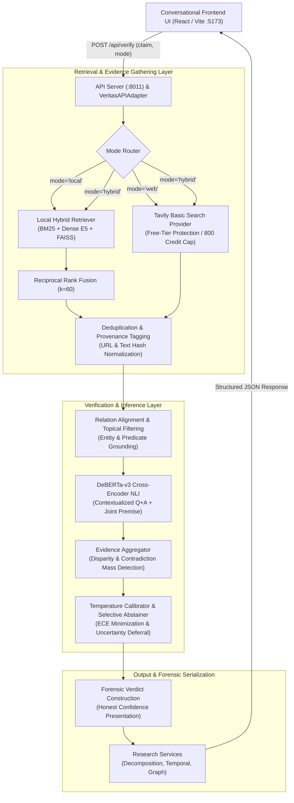

# VERITAS-X — System Architecture & Data Flow

This document details the complete end-to-end architecture and runtime data flow of the **VERITAS-X Evidence-Grounded AI Fact-Verification Platform**.

---

## 1. High-Level Architectural Diagram

---

## 2. End-to-End Data Flow Stages

### Stage 1: Input Ingestion & Mode Selection
- **Input**: A natural language claim string (e.g., `"Humans use only 10% of their brains."`) and an explicit retrieval mode:
  - `local`: Offline verification against pre-indexed corpus.
  - `web`: Real-time online verification via live Tavily basic search.
  - `hybrid`: Combined local corpus passages and live web search citations.
- **Validation**: Sanitization of input text, trimming whitespace, and validating mode parameters in `api.server` and `VeritasAPIAdapter`.

### Stage 2: Evidence Retrieval Engines

#### A. Local Corpus Retrieval
- **Lexical Matching**: BM25 with tuned term weighting over the verified offline corpus.
- **Dense Semantic Embeddings**: Multilingual E5 (`intfloat/multilingual-e5-small`) generating dense 384-dimensional query embeddings with query prefix `query: `.
- **FAISS Index**: Fast approximate nearest-neighbor vector search with content hash validation to detect stale index caches.
- **Reciprocal Rank Fusion (RRF)**: Merges BM25 and dense ranking lists using $RRF(d) = \sum \frac{1}{60 + r(d)}$.

#### B. Live Web Retrieval (Tavily Provider)
- **Zero Key Exposure**: API key resolved strictly from backend environment or `D:\VERITAS-X\.env`. Never exposed to frontend or client logs.
- **Strict Free-Tier Cost Safeguard**:
  - Only `basic` search depth is enabled (1 search credit per request).
  - Application-level monthly ceiling of **800 credits** enforced by persistent atomic ledger `data/tavily_usage.json`.
  - Zero automated retries on failure (prevents credit burn loops on transient errors).
  - Permanent current-month lockout on HTTP 402/429 billing or quota responses.
- **Provenance Normalization**: Each candidate passage records `source_url`, `source_title`, `published_date`, `source_type="web"`, and an excerpt text snippet.

### Stage 3: Passage Normalization & Deduplication
- Strips URL query tracking parameters and fragment identifiers (`re.sub(r"[?#].*$", "", url)`).
- Generates 16-character SHA-256 text hashes for text uniqueness.
- Deduplicates identical or mirrors of the same source passage, preventing duplicate web results or local overlaps from artificially inflating model confidence.

### Stage 4: Relation Alignment & Topical Filtering
- Before evidence influences the verdict, passages are checked for:
  1. **Subject/Entity Alignment**: Ensures the passage mentions the primary claim entities.
  2. **Predicate/Action Alignment**: Distinguishes mere entity mentions from asserted actions or dates (e.g., Amy Coney Barrett's confirmation date requires date-specific evidence, not general biographical articles).
  3. **Distractor Suppression**: Prevents high NLI contradiction scores on unrelated premises from acting as factual refutations.

### Stage 5: NLI Stance Prediction
- **Model**: `MoritzLaurer/DeBERTa-v3-base-mnli-fever-anli` cross-encoder.
- **Pair Construction**: Premise context formatted as `Context: {passage_text}` and hypothesis as `{claim_text}`.
- **Joint-Premise Evaluation**: Evaluates candidate pairs jointly when multi-sentence premises are required for multi-hop syllogistic reasoning.
- **Probabilities**: Outputs softmax probabilities across $[P(\text{entailment}), P(\text{neutral}), P(\text{contradiction})]$.

### Stage 6: Evidence Aggregation & Stance Disparity Detection
- Evaluates aggregate evidence mass across all valid retrieved passages:
  - Strong entailment mass $\rightarrow$ candidate `VERIFIED_TRUE`.
  - Strong contradiction mass $\rightarrow$ candidate `VERIFIED_FALSE`.
  - Coexistence of opposing strong evidence ($P_{\text{entail}} \ge 0.35 \land P_{\text{contra}} \ge 0.35$) triggers `CONFLICTING_OR_CHERRYPICKED` with cross-passage disparity flag.
  - Dominant neutral or uninformative evidence $\rightarrow$ candidate `INSUFFICIENT_EVIDENCE`.

### Stage 7: Temperature Calibration & Selective Abstention
- **Temperature Scaling**: Uncalibrated model logits are scaled via temperature parameter $T$ optimized via Negative Log-Likelihood (NLL) minimization on validation data:
  $$\hat{p}_k = \frac{\exp(z_k / T)}{\sum_j \exp(z_j / T)}$$
- **Selective Abstention**:
  - If calibrated confidence falls below the optimal coverage threshold, the engine abstains (`was_abstained=True`).
  - Distinguishes operational abstention from factual assertion.
  - Generates clear, honest justification explaining whether abstention was due to low confidence, zero passages found, or ungrounded evidence.

### Stage 8: Conversational Presentation & Research Services
- **Claim Investigator (Default View)**: Clean conversational card showing plain-language verdict badge, honest confidence label, evidence mode indicator, concise rationale, and evidence excerpts with source links.
- **Research Workspaces (Full Diagnostic Access)**:
  - **Evidence Dossier**: Granular breakdown of individual passages, stance classifications, and snippet badges.
  - **Evidence Graph**: Visual bipartite graph connecting claims, subclaims, and evidence nodes.
  - **Temporal & Provenance Timeline**: Chronological event mapping and date disparity alerts.
  - **Multi-Hop Reasoning**: Subclaim decomposition and resolution trees.
  - **Model Performance Lab**: Calibration curves, confusion matrix, and benchmark metrics.
  - **System Telemetry**: Real-time latency breakdowns, memory status, device, and monthly search credit usage.
